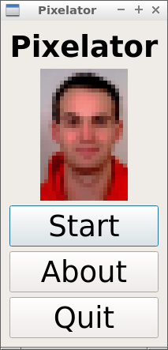
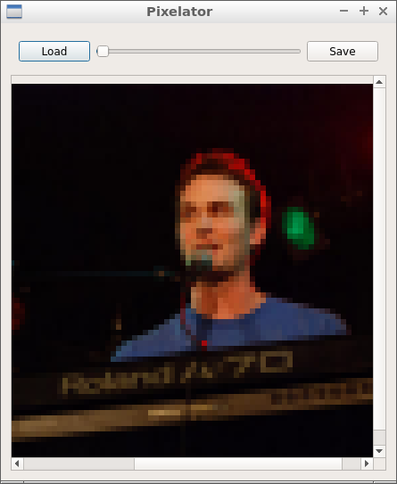

# Pixelator

[Go to the nicely rendered
website](https://richelbilderbeek.github.io/Pixelator/).

C++ tool to create a pixelated effect using Qt.





## Getting this to run

### Download this project

```bash
git clone https://github.com/richelbilderbeek/Pixelator
```

This will create a folder called `Pixelator`.

### Build this project

### Go into the folder created

```bash
cd Pixelator
```

### Install the other GitHubs needed

```text
download_other_githubs.sh
```

This will create folders *next* to `Pixelator`, that is, in the same folder that
you've downloaded `Pixelator`.

### Building the console version

On GNU/Linux, you can call the bash build script:

```bash
./build_console.sh
```

You can now run the executable created.

Or you can open the Qt Creator project file `PixelatorConsole.pro` and click
`Run`.

### Building the desktop version

On GNU/Linux, you can call the bash build script:

```bash
./build_desktop.sh
```

Or you can open the Qt Creator project file `PixelatorDesktop.pro` and click
`Run`.

